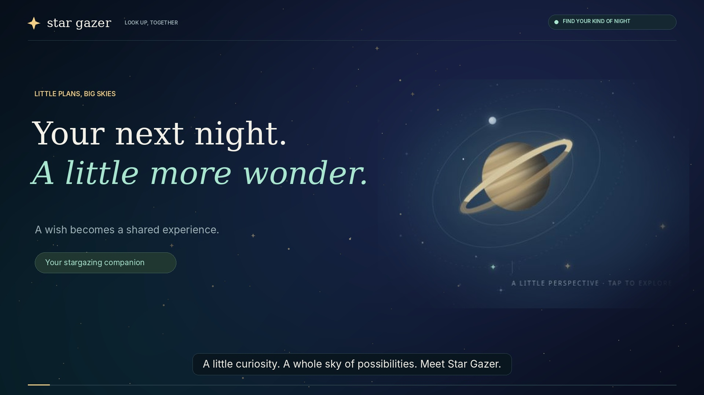
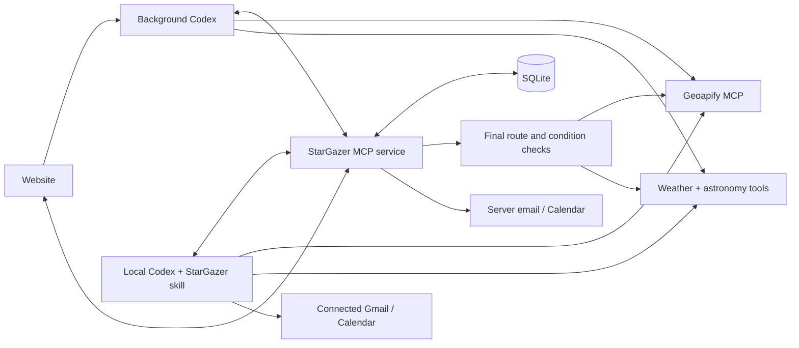

# StarGazer

**Find the night, the place and the company.**

Plan a stargazing evening, join an open outing, and grow a circle of people who
love looking up. Use the website or work entirely in Codex. By Michal Novotný,
Czech Republic. **Version 0.4.0 · [MIT license](LICENSE).**

[Public repository](https://github.com/clime-alertviz/StarGazer) · [Release v0.4.0](https://github.com/clime-alertviz/StarGazer/tree/v0.4.0)

[](docs/showcase.mp4)

**[Watch the video](docs/showcase.mp4)** · [Written walkthrough](docs/walkthrough.md)
· [Tutorial page](docs/index.html) · [Example requests](examples/requests.md)

The video is included in this repository: English voiceover, captions, original
music and gentle sound effects. If GitHub shows a file page instead of a player,
choose **View raw / Download**, or open `docs/index.html` from your checkout.
You can also run `npm run tutorial` and open [the local tutorial](http://127.0.0.1:4320).

Places and journeys are powered by **[Geoapify](https://www.geoapify.com/)**.
Weather comes from Open-Meteo; sky calculations use Astronomy Engine.

## Try the web demo

Requires **Node.js 22.13+** and npm. **AI matching and creating new plans also
require a signed-in Codex CLI on the machine running the web server.** The install
command below includes the CLI; the web server starts it automatically. You do
not need to keep the Codex desktop app or a chat open. Codex uses your account's
online models; the model itself does not run locally.

For the full experience:

```bash
npm ci --ignore-scripts
cp .env.example .env
npx codex login
# Set GEOAPIFY_API_KEY in .env before starting the server.
npm run seed
npm run web:demo
```

If you already have a `.env`, keep it rather than copying over it. An OpenAI API
key is not required.

Open **[http://127.0.0.1:4318](http://127.0.0.1:4318)**. Eight varied outings are
seeded; the public page shows those that are open and have places available.

1. Browse an evening. Choose **Sign in** and enter `mia@stargazer.test`.
2. Open **Local outbox**, follow the sign-in link, then click **Continue**.
3. Open an outing → **Check my journey & join** → review your journey → join.
4. Or choose **Plan your next adventure** to organize your own evening.

For a limited preview, you can skip Codex login and the Geoapify key: browse the
sample outings, sign in through Local outbox, and join with self-arranged
transport. AI matching and new AI-generated plans require Codex login; live
address search and checked journeys require `GEOAPIFY_API_KEY`. Restart the
server after adding credentials.

The demo is the same app with its own SQLite database in `private/community-demo`.
For your own empty community, use `npm run web` and
[http://127.0.0.1:4317](http://127.0.0.1:4317); its data stays in `private/web`.
Only run one server per database. To refresh the sample dates, stop the demo,
run `npm run seed -- --reset`, and restart it. Reset is restricted to the demo directory.

## Keys and invitations

All credentials come from **environment variables** or the ignored **`.env`** file.
The repository and plugin contain only blank/example values.

| Variable | When you need it |
| --- | --- |
| `GEOAPIFY_API_KEY` | Live addresses, places and journeys |
| `SMTP_URL`, `MAIL_FROM` | Real sign-in emails and a system mail sender |
| `GOOGLE_CLIENT_ID`, `GOOGLE_CLIENT_SECRET` | Server-managed Gmail/Calendar connection |
| `STAR_GAZER_URL`, `STAR_GAZER_TOKEN` | Connect local Codex to your StarGazer account |
| `OPEN_METEO_API_KEY` | Optional, when using a subscribed Open-Meteo endpoint |

Email and Google Calendar are alternative invitation channels. Guests can always
respond on the outing page. Edits update the same Calendar event; cancellation
cancels it. Local testing uses **Local outbox**. Real delivery requires a connected
sender: follow [email and Google setup](docs/providers.md).

## Install the Codex plugin

Keep the service running. Sign in on the website, open **Settings**, and choose
**Create MCP access token**. Add these client settings to your local `.env`:

```dotenv
STAR_GAZER_URL=http://127.0.0.1:4318
STAR_GAZER_TOKEN=your-token-from-settings
GEOAPIFY_API_KEY=your-geoapify-key
```

Then install the package:

```bash
npm run package
codex plugin marketplace add ./output/marketplace
codex plugin add star-gazer@star-gazer-local
npm run codex
```

Start a new chat and ask:

> Use StarGazer. Find an open evening where someone can show me the Moon.
> I can make my own way. Show me the plan before I join.

Or:

> Use StarGazer to organize a quiet evening with my circle. Do the matching here
> in Codex, check the sky and journeys, and save a draft for me to review.

`npm run codex` supplies the client variables from `.env`. For Codex Desktop,
provide them in the environment that launches the app, then enable the installed
plugin in a new chat. Node must be on PATH. Installation packages dependencies,
**not** your `.env`, database or tokens. Rebuild and reinstall to update it.

Without a token, the MCP `request_signin` tool can request the sign-in link;
finish sign-in and generate the token in Settings. A hosted `STAR_GAZER_URL` uses
the same tools, including remote outing creation. See [AI workflow](docs/ai-workflow.md)
for the sign-in endpoint and complete tool sequences.

## Website or your local Codex



The **LLM compares people, places, times and preferences**. Shared checks enforce
capacity, equipment, complete journeys, availability, weather and astronomy.
The submitted evening is authoritative for that outing; old profile slots cannot
silently replace it. Other participants retain their own limits.

Local Codex can plan and save through MCP with **no backend LLM**. It can also
send through its connected Gmail/Calendar integrations, recording delivery
receipts so the server does not send twice. The website uses a background Codex
agent and server-managed delivery. [Full workflow and prompts](docs/ai-workflow.md)
· [Solver details](docs/solvers.md).

## Reproduce the checks

```bash
npm test                       # automated regressions, no live credentials
npm run check                  # plugin manifests, configuration and examples
npm run demo                   # repeatable planner fixture and tool-call trace
```

Optional integration checks:

```bash
npm run test:live-client        # real local Codex, fixture providers
npm run test:live-solver        # real background Codex, fixture providers
npm run test:live-providers     # live Geoapify/Open-Meteo; needs your key
npm run verify:install         # installed MCP package, isolated fixture service
```

[Trace index](examples/README.md) identifies inputs, results and how each recording
was produced. [Verification](docs/verification.md) records the tested scope.
Geoapify traffic is an approximation, not live congestion or a departure-time
forecast. Weather can change; mapped places still need night-access confirmation.
Poor weather can produce a private draft with a warning. You decide whether to
invite anyway; walking limits, complete availability and astronomy still apply.

## Submission contents

| Requested item | Where to find it |
| --- | --- |
| Setup and runnable demo | Commands above; `npm run web:demo` |
| Walkthrough | [Video](docs/showcase.mp4), [written tutorial](docs/walkthrough.md), [HTML page](docs/index.html) |
| Prompts and AI workflow | [Example requests](examples/requests.md), [workflow](docs/ai-workflow.md), [StarGazer skill](skills/star-gazer/SKILL.md) |
| Tool calls and lessons | [Recorded traces](examples/README.md), [Geoapify feedback](docs/geoapify-feedback.md) |
| License and release | [MIT](LICENSE), version **0.4.0** in [package.json](package.json), [release/tag steps](docs/release.md) |

This repository contains both the video demo and runnable app; no separate
public app hosting is required. Use the **v0.4.0** tag for the submission snapshot.
